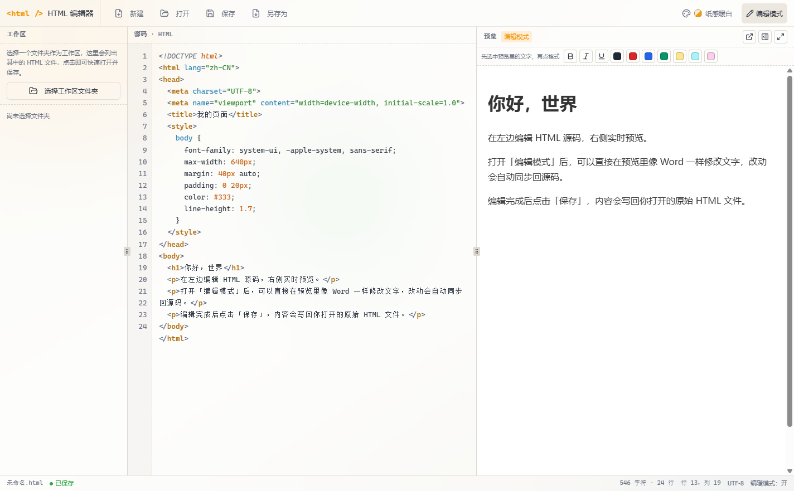

# HTML Editor

一款轻量的 HTML 源码编辑器，左侧编写代码，右侧实时预览；开启编辑模式后可直接在预览画布中像 Word 一样修改文字，改动自动同步回源码。提供 Windows 便携版与安装版。



## 特性

- 三栏工作区：文件列表、源码编辑、实时预览，栏宽可拖拽调整
- 源码区行号 + HTML 语法高亮，透明输入层保证原生编辑手感
- 预览画布所见即所得编辑，输入节流批量回写，避免逐键重排卡顿
- 格式工具栏：加粗、斜体、下划线、文字颜色、高亮颜色
- 预览可分离为独立窗口，或在系统默认浏览器中打开
- 五套主题配色：纸感暖白、暗夜、森林、海洋、石墨
- 草稿本地自动保存，重新打开不丢失未提交内容
- 支持打开本地 HTML 文件、保存与另存为
- 桌面壳启动画面与应用图标，便携版数据跟随程序目录

## 技术栈

- React 19 + TypeScript
- Vite 8
- Tailwind CSS v4 + shadcn/ui
- react-router-dom 7
- highlight.js 11
- react-resizable-panels
- sonner
- Electron 44

## 快速开始

安装依赖：

```bash
npm install
```

本地开发（浏览器预览，默认端口 32123）：

```bash
npm run dev
```

类型检查与 lint：

```bash
npm run lint
```

构建桌面端前端产物（资源使用相对路径，供 Electron 以 `file://` 加载）：

```bash
ELECTRON_BUILD=1 npm run build
```

## 目录结构

```
electron/            # Electron 主进程、预加载脚本、启动画面
src/
├── components/ui/   # shadcn/ui 基础组件
├── lib/             # 文件读写、草稿存储、主题等工具
├── pages/EditorPage/# 编辑器页面与各分区面板
└── index.css        # 全局样式与主题变量
assets/              # 应用图标
scripts/             # staging 组装与 asar 打包脚本
docs/                # 文档与界面截图
```

## 下载

Windows 安装包与便携版在 [Releases](./releases) 页面获取。

- 安装版：静默安装到当前用户目录，开始菜单与桌面快捷方式可选
- 便携版：单文件自解压，用户数据存放在程序旁的 `.data` 目录，可整体拷贝携带

## 说明

- 桌面端以 `file://` 加载产物，路由使用 HashRouter；浏览器开发环境使用 BrowserRouter
- 预览内的链接在编辑模式下被拦截，站内锚点可手动定位跳转
